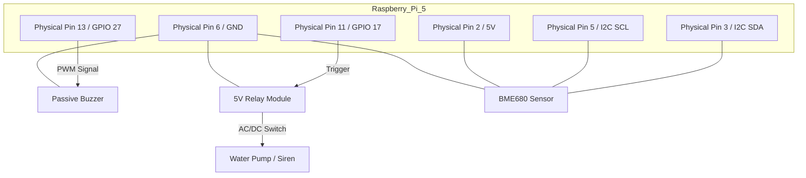

# 🔥 Federated Learning Fire Node

### Edge-AI Powered Hazard Detection with Local LLM Reasoning

## 📖 Project Overview

The **Federated Learning Fire Node** is an intelligent edge-based fire detection system designed to operate independently on a **Raspberry Pi 5**.

This project combines:

* 🧠 **Local LLM reasoning**
* 👁️ **YOLO-based computer vision**
* 🌡️ **BME680 environmental sensing**
* ⚡ **Federated learning principles**

Unlike traditional cloud-based systems, this node performs **on-device inference and learning**, ensuring:

* 🔒 Data privacy
* ⚡ Low latency
* 🌐 Decentralized intelligence

The system is capable of **multi-modal sensor fusion**, allowing it to distinguish between:

* Harmless anomalies (e.g., steam, cooking smoke)
* Real fire hazards

---

## 🚀 Key Features

* 🔥 **Real-time fire detection**
* 🧠 **Local LLM-based reasoning engine**
* 📷 **YOLO vision processing**
* 🌡️ **Gas + temperature + humidity sensing**
* 🔄 **Federated learning-ready architecture**
* 🔕 **False positive reduction using contextual reasoning**
* ⚡ **Edge deployment (no cloud dependency)**

---

## 🧠 System Architecture

The system integrates three main AI components:

1. **Vision Model (YOLO)**
   Detects smoke, flame, and visual anomalies via Pi Camera.

2. **Sensor Model (XGBoost + BME680)**
   Analyzes:

   * Gas levels
   * Temperature
   * Humidity

3. **Local LLM Reasoning Engine**
   Combines outputs from both models to make **human-like decisions**.

---

## 🔌 Circuit Diagram



---

## 🛠️ Hardware Stack

| Component          | Connection       | Role                         |
| ------------------ | ---------------- | ---------------------------- |
| **BME680**         | I2C (Pins 3, 5)  | Gas, Temp & Humidity sensing |
| **Passive Buzzer** | GPIO 27 (Pin 13) | Audio alert (PWM)            |
| **Relay Module**   | GPIO 17 (Pin 11) | Controls suppression system  |
| **Pi Camera V3**   | CSI Port         | Vision input for YOLO        |

---

## ⚙️ Software Setup & Deployment

### 1️⃣ Clone the Repository

```bash
git clone https://github.com/YOUR_USERNAME/Fire-Node-Project.git
cd Fire-Node-Project
```

### 2️⃣ Setup Environment

```bash
python3 -m venv venv
source venv/bin/activate
pip install -r requirements.txt
```

### 3️⃣ Run the Node

```bash
python3 inference.py
```

---

## 📂 Project Structure

```
/home/pi/fire_project/
│
├── inference.py          # Core AI logic (LLM + fusion)
├── requirements.txt      # Dependencies
├── dataset/              # Logs and training data
│
├── venv/                 # Virtual environment
│
└── models/               # ⚠️ Manually added
    ├── yolo_model.pt     # YOLO weights
    └── llm_model.gguf    # Quantized LLM
```

---

## ⚠️ Important Note

Due to GitHub’s **100MB file limit**, AI model weights are NOT included.

You must manually copy:

* `.pt` (YOLO model)
* `.gguf` (LLM model)

### Transfer Options:

* USB drive
* SCP / SFTP
* External storage
---

## 🔐 Privacy & Federated Learning

This project follows **Federated Learning principles**:

* Data remains **on-device**
* Only model updates (optional) are shared
* No raw sensor data leaves the node

---

## 🔮 Future Enhancements

* 🌐 Multi-node federated network
* 📡 Edge-to-edge communication
* 📱 Mobile alert system
* ☁️ Optional cloud dashboard
* 🎯 Improved anomaly classification

---

## 🤝 Contributions

Contributions are welcome!
Feel free to fork, improve, and submit pull requests.

---

If you want, I can also:

* Make this more **“college project report friendly”**
* Add **architecture diagrams + flowcharts**
* Or tailor it for **GitHub portfolio (to impress recruiters)** 🚀
