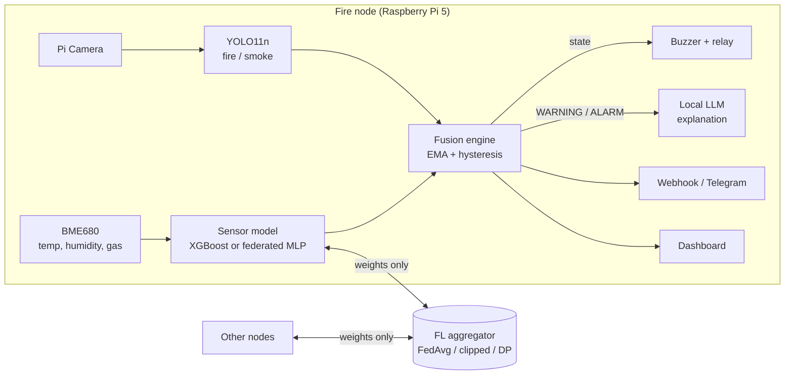
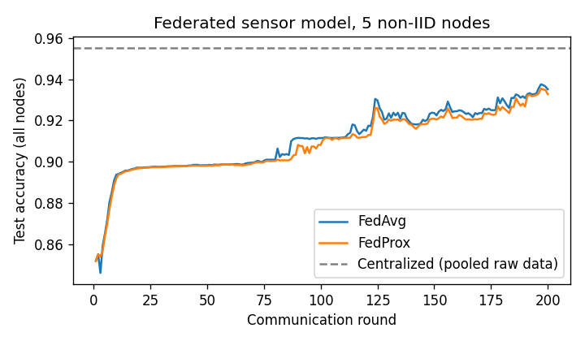
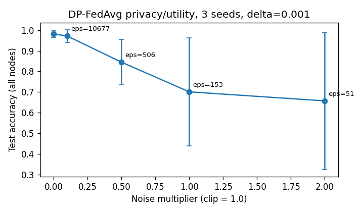
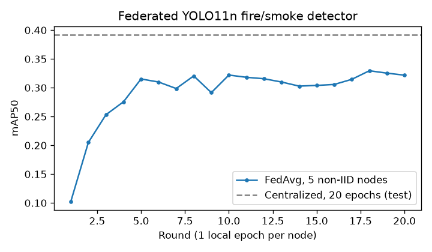
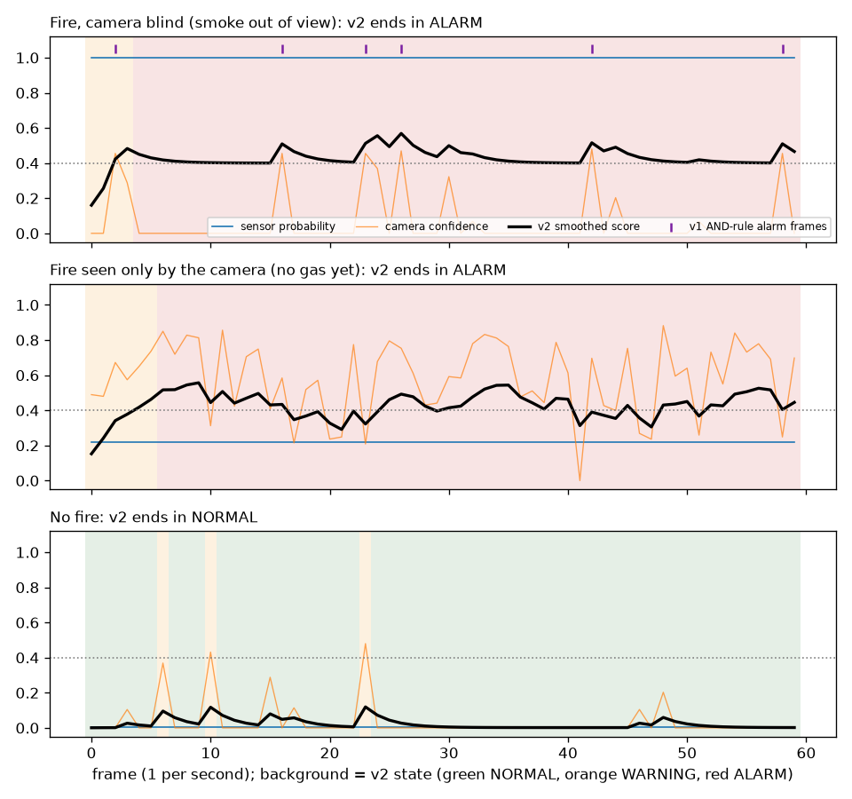
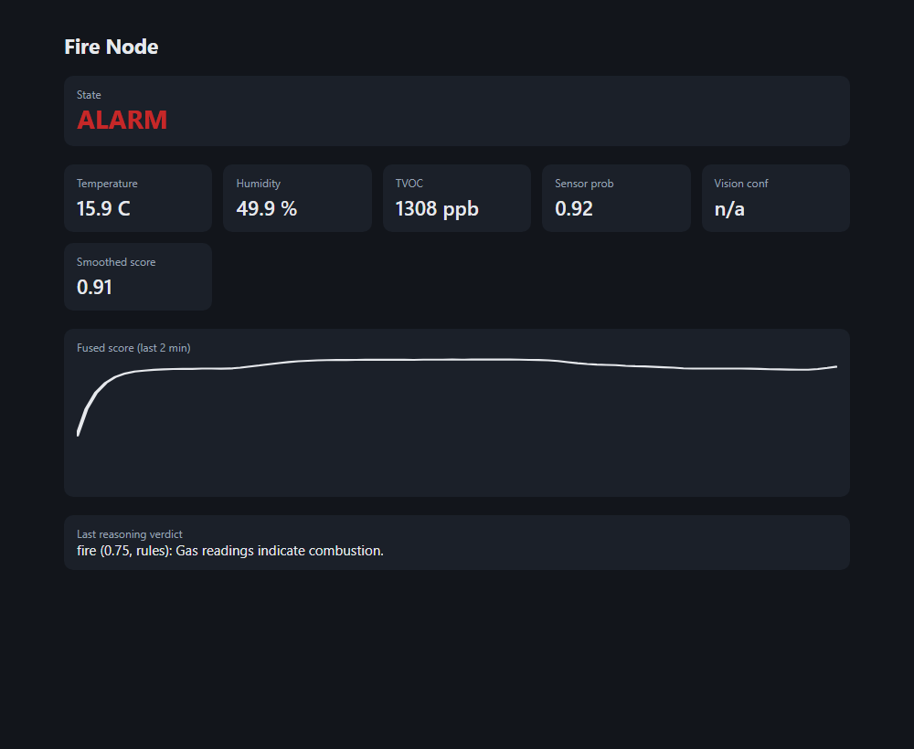

# Multimodal Federated Fire Detection Node

Edge fire detection for a Raspberry Pi 5 that fuses a gas/temperature sensor
(BME680 + XGBoost) with a camera (YOLO11n). The sensor models are trained
across sites with federated learning, and a small local LLM explains alerts.
Every number below is produced by a script in this repo, on held-out data.

## What it does

| Part | Implementation |
|---|---|
| Sensor pathway | XGBoost on temperature, humidity, TVOC, pressure (`models/sensor_xgb.json`) |
| Vision pathway | YOLO11n fire/smoke detector, 416 px (`scripts/train_vision.py`) |
| Fusion | Weighted late fusion, EMA smoothing, NORMAL→WARNING→ALARM state machine with hysteresis (`firenode/fusion.py`) |
| Federated learning (sensor) | NumPy MLP, FedAvg / FedProx / clipped equal-weight aggregation / DP-FedAvg; HTTP aggregator and node client (`federated/`); nodes run the federated model (`sensor_type: fl_mlp`) |
| Federated learning (vision) | YOLO11n trained with FedAvg across 5 non-IID camera nodes (`scripts/federated_vision.py`) |
| Local LLM reasoning | Qwen2.5 Instruct (GGUF, Q4_K_M) explains WARNING/ALARM events; escalation off by default after failing validation (`firenode/reasoning.py`) |
| Alerts | JSON webhook and Telegram on state changes, sent off the alarm path (`firenode/alerts.py`) |
| Dashboard | Live status page served by the node (`--dashboard PORT`) |
| Multi-node demo | `docker compose up`: aggregator + 5 nodes + alert sink |
| Hardware | Buzzer GPIO27 (pin 13), relay GPIO17 (pin 11), BME680 on I2C |



## Results

### Vision (YOLO11n, held-out test split, 893 images)

| Version | Training | Evaluated on | mAP50 | mAP50-95 |
|---|---|---|---|---|
| v1 | 5 epochs, CPU, 320 px | its own training images | 0.373 | 0.182 |
| **v2** | 50 epochs, GPU, 416 px | **held-out test split** | **0.427** | **0.208** |

Per class mAP50 (v2): fire 0.62, smoke 0.43, other 0.23. Inference about 1.2 ms
per image on an RTX 5060 laptop GPU. Raspberry Pi latency has not been measured yet.

### Fusion (replay benchmark, test split)

No public dataset pairs camera frames and gas readings from the same fire,
so episodes (60 frames each, 200 per type) combine held-out sensor windows
with held-out test images. Fusion thresholds were tuned on the validation
split (`config/tuned_fusion.yaml`), then evaluated once on test.

Cells: share of episodes that reached ALARM, with the mean number of times the
alarm switched on or off per episode in brackets.

| Policy | Fire, both see it | Fire, camera blind | Fire, no gas yet | No fire (false alarm) |
|---|---|---|---|---|
| Sensor only | 1.00 (0.0) | 1.00 (0.0) | 0.03 (0.0) | 0.02 (0.0) |
| Vision only | 1.00 (21.6) | 0.96 (5.5) | 1.00 (21.4) | 0.94 (5.3) |
| v1 AND rule | 1.00 (21.6) | 0.96 (5.5) | 0.03 (0.3) | 0.01 (0.0) |
| **v2 fusion** | **1.00 (1.0)** | **1.00 (1.0)** | **0.92 (0.9)** | **0.01 (0.0)** |

v2 catches 92% of fires visible only to the camera (v1: 3%) at the same 1%
false-alarm rate, and does not flicker the alarm on and off.

### Sensor model (XGBoost)

| Split | Accuracy |
|---|---|
| Random row split (v1 protocol) | 99.5% |
| Chronological split per session | 99.8% |
| **Leave one session out (new site)** | **3% – 88%** depending on session |

The model is near-perfect on the sites it trained on but does not transfer to
an unseen site. This motivates training across sites with federated learning.

### Federated learning (5 non-IID nodes = 5 recording sessions)

| Method | Pooled test accuracy |
|---|---|
| Local only (each node alone, evaluated on all nodes) | 42.8% mean |
| FedAvg | 93.5% |
| FedProx (mu = 0.1) | 93.3% |
| Centralized (pooled raw data, no privacy) | 95.5% |
| **Clipped equal-weight aggregation** | **98.2% ± 1.5** (3 seeds) |
| Same, over HTTP with 5 separate processes | 98.8% |

DP-FedAvg (clip 1.0, delta 1e-3, 200 rounds, 3 seeds):

| Noise multiplier | epsilon | Accuracy |
|---|---|---|
| 0.1 | 10677 | 97.2% |
| 0.5 | 506 | 84.5% |
| 1.0 | 153 | 70.1% |
| 2.0 | 51 | 65.7% |

With only 5 nodes and full participation, a meaningful privacy budget costs a
lot of accuracy. More nodes per round would be needed for strong guarantees.




### Federated vision (YOLO11n, 5 non-IID camera nodes)

Training images split across 5 nodes with a Dirichlet(0.5) split by dominant
class: one node has almost only fire, one has no fire at all. Each round every
node trains one local epoch from the global weights; the server averages them.

| Model | Test mAP50 | mAP50-95 |
|---|---|---|
| FedAvg, 20 rounds × 1 local epoch | 0.296 | 0.129 |
| Centralized, same optimizer and budget (20 epochs) | 0.392 | 0.190 |
| Centralized, 50 epochs (deployed model) | 0.427 | 0.208 |

FedAvg reaches about 75% of centralized mAP without any node sharing images;
the gap is the usual cost of strongly non-IID data.



### Edge deployment (vision model, desktop CPU pinned to 4 cores)

`scripts/export_edge.py` exports the deployed model and measures each format
on the held-out test split. Latency is end-to-end `predict()` per image at
416 px on an Intel i7-13650HX limited to 4 cores (a Pi 5 has 4); Raspberry Pi
numbers still need to be measured by running the same script on the device.

| Format | Size | Median latency | p95 | Test mAP50 |
|---|---|---|---|---|
| PyTorch fp32 | 5.2 MB | 44 ms | 46 ms | 0.427 |
| ONNX fp32 | 10.1 MB | 64 ms | 131 ms | 0.416 |
| NCNN fp32 | 10.0 MB | 42 ms | 47 ms | 0.416 |
| NCNN fp16 | 5.0 MB | 43 ms | 49 ms | 0.416 |
| **OpenVINO INT8** | **3.2 MB** | **25 ms** | **39 ms** | **0.415** |

INT8 quantization makes the model 1.8× faster and 39% smaller than PyTorch
for a 0.001 mAP50 drop against the fp32 exports. `config/pi.yaml` selects the
NCNN export, the format Ultralytics recommends for Raspberry Pi CPUs.

### Fusion over time

One held-out episode per situation; the black line is the v2 smoothed score,
the background is the v2 state, purple ticks are frames where the v1 rule alarmed.



### Local LLM reasoning: evaluated, kept advisory

On every WARNING the node summarizes the last 30 readings for a local LLM and
logs its verdict and explanation. Four configurations were compared on
validation episodes (20 per type); the best one was then run once on test.

| Validation (verdict accuracy) | Fire, both | Camera blind | No gas yet | **No fire** | Median latency |
|---|---|---|---|---|---|
| Qwen2.5-0.5B, zero-shot | 0.95 | 1.00 | 0.90 | **0.00** | 2.2 s |
| Qwen2.5-0.5B, few-shot | 0.00 | 0.00 | 0.00 | **1.00** | 3.4 s |
| Qwen2.5-1.5B, zero-shot | 1.00 | 1.00 | 1.00 | **0.00** | 8.3 s |
| Qwen2.5-1.5B, few-shot | 1.00 | 1.00 | 0.95 | **0.00** | 5.0 s |
| Rule-based fallback | 1.00 | 0.90 | 1.00 | 0.25 | <1 ms |

(Latency on an RTX 5060 laptop GPU through transformers.) None of these small
models separates fire from no-fire: each gives almost the same answer whatever
the readings say. On test, letting Qwen2.5-1.5B escalate WARNING to ALARM
raised the false-alarm rate on no-fire episodes from 0% to 87%. Escalation is
therefore **off by default**; the LLM only writes explanations into the
incident log and dashboard, and the fusion engine alone decides alarms.
Results: `results/reasoning_eval_val.json`, `results/reasoning_eval_test.json`.

## Setup

```bash
python -m venv .venv && .venv\Scripts\activate          # Linux/macOS: source .venv/bin/activate
pip install torch torchvision --index-url https://download.pytorch.org/whl/cu128   # GPU; omit for CPU
pip install -r requirements.txt -r requirements-edge.txt
python scripts/download_dataset.py      # needs ROBOFLOW_API_KEY (dataset: CC BY 4.0)
python train.py                         # splits, sensor, vision, FL, fusion stages
pytest -q                               # 36 tests, no hardware needed
```

Run the node without hardware (replays recorded sensor data):

```bash
python inference.py --replay --no-camera --dashboard 8000
```

Optional LLM model (about 470 MB):

```bash
python -c "from huggingface_hub import hf_hub_download; hf_hub_download('Qwen/Qwen2.5-0.5B-Instruct-GGUF','qwen2.5-0.5b-instruct-q4_k_m.gguf',local_dir='models')"
```

Networked federated training (one aggregator, one process per node):

```bash
python scripts/fl_network_demo.py --clip 1.0
```

### Multi-node demo with Docker

```bash
docker compose up --build
```

Starts the aggregator, five nodes and an alert sink. Each node trains the
shared sensor model over HTTP using only its own recording session, then runs
the full node loop on its held-out readings with that federated model.
Dashboards: http://localhost:8100 to 8104. Alerts received: http://localhost:9000/events.

In a test run, nodes 0–2 (held-out readings contain fire) went to ALARM,
nodes 3–4 (no fire) stayed NORMAL, and the sink received 6 webhook alerts
(WARNING then ALARM from each fire node).



### Alerts

Set `FIRENODE_WEBHOOK_URL` for JSON webhooks, or `TELEGRAM_BOT_TOKEN` and
`TELEGRAM_CHAT_ID` for Telegram. Alerts go out on a background thread with
timeouts, so a slow network never delays the buzzer or relay.

Deploy to a Raspberry Pi 5 (SSH key auth, installs a systemd service):

```bash
python deploy.py --host <pi-address> --user pi
```

## Project structure

```
firenode/     node runtime: fusion, sensors, models, actuators, reasoning, dashboard
federated/    FL model, aggregation (FedAvg/FedProx/DP), HTTP server and client
scripts/      dataset, training, FL experiments, benchmarks
config/       default.yaml (+ tuned_fusion.yaml from the benchmark)
results/      metrics JSON and plots produced by the scripts
tests/        pytest suite (runs in CI)
deploy/       systemd unit, Docker node entrypoint, webhook sink
```

## Limitations

- Hardware code (BME680, GPIO, camera) has not been re-tested on a Pi after the v2 rewrite.
- No dataset pairs camera frames with gas readings from the same fire; fusion is
  evaluated on replay episodes assembled from held-out sensor windows and test images.
- Federated "nodes" are recording sessions of one public dataset, not separate deployments.
- The BME680 gives gas resistance, not TVOC; the conversion is approximate.
- Small local LLMs (0.5B and 1.5B) did not pass validation as decision makers; they only explain.
- Edge latency was measured on a desktop CPU limited to 4 cores, not on a Raspberry Pi.

## Data

- Images: [Roboflow Fire Detection v1](https://universe.roboflow.com/fire-dataset-tp9jt/fire-detection-sejra/dataset/1), CC BY 4.0, 8,939 images.
- Sensor readings: `smoke_detection_iot.csv`, public smoke detection IoT dataset (62,630 rows).
